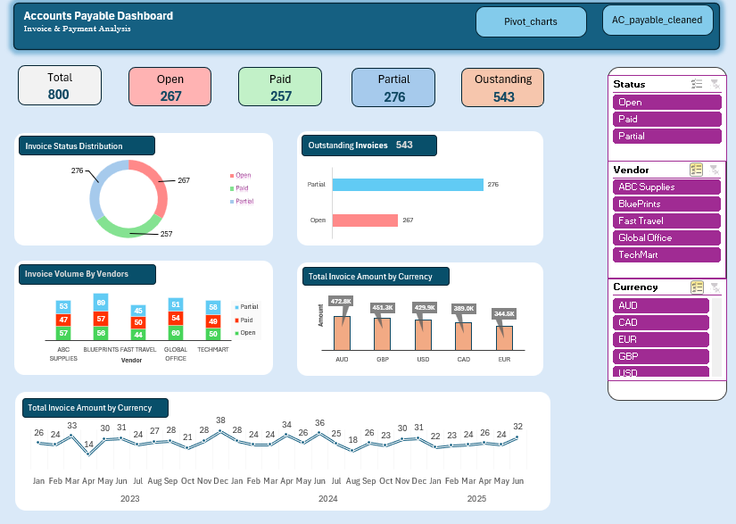

# Accounts Payable Analytics Dashboard

An interactive Accounts Payable (AP) dashboard built using Microsoft Excel to analyse invoice records, monitor payment statuses, and track vendor activity.

## 📊 Dashboard Preview

## 🎯 Project Overview

This project focuses on analysing Accounts Payable data to provide insights into invoice volumes, payment statuses, vendor activity, currency-wise invoice values, and monthly invoice trends.

The dashboard enables users to interact with the data through slicers and explore different aspects of invoice performance.

## 📁 Dataset Overview

- **Total Records:** 800 invoices
- **Vendors:** 5
- **Currencies:** AUD, CAD, EUR, GBP, USD
- **Data Period:** 2023–2025
- **Data Type:** Practice dataset

## 🛠️ Tools & Skills Used

- Microsoft Excel
- Power Query for data cleaning and transformation
- Pivot Tables
- Pivot Charts
- Excel Slicers
- KPI Cards
- Data Analysis and Visualisation

## 📌 Key Performance Indicators

The dashboard tracks five key metrics:

| KPI | Value |
|---|---:|
| Total Invoices | 800 |
| Open Invoices | 267 |
| Paid Invoices | 257 |
| Partially Paid Invoices | 276 |
| Outstanding Invoices | 543 |

*Outstanding invoices include Open and Partially Paid invoices.*

## 📈 Dashboard Visualisations

The dashboard includes five main visualisations:

1. **Invoice Status Distribution** – Shows the distribution of Open, Paid, and Partially Paid invoices.
2. **Outstanding Invoice Breakdown** – Highlights Open and Partially Paid invoice counts.
3. **Invoice Volume by Vendor** – Compares invoice volumes across vendors.
4. **Total Invoice Amount by Currency** – Displays invoice amounts separately by currency.
5. **Monthly Invoice Volume Trend** – Tracks invoice activity across 2023, 2024, and 2025.

## 🎛️ Interactive Features

The dashboard includes three slicers:

- **Status:** Filter invoices by payment status.
- **Vendor:** Analyse individual suppliers.
- **Currency:** Explore invoice records by currency.

These interactive filters allow users to investigate the data from different perspectives.

## 💡 Key Business Applications

This dashboard can help accounts payable teams:

- Monitor unpaid and partially paid invoices.
- Identify vendor-wise invoice activity.
- Review payment status distribution.
- Track monthly invoice trends.
- Analyse invoice values across different currencies.

**Note:** Currency-wise amounts are displayed separately and are not combined into a single financial total.

## 📂 Project Files

- `Accounts_Payable_Dashboard.xlsx` – Excel dashboard and analysis workbook.
- `dashboard-preview.png` – Dashboard screenshot.

## 👨‍💻 Author

Created as a practical portfolio project to develop skills in Microsoft Excel, financial data analysis, and business reporting.
